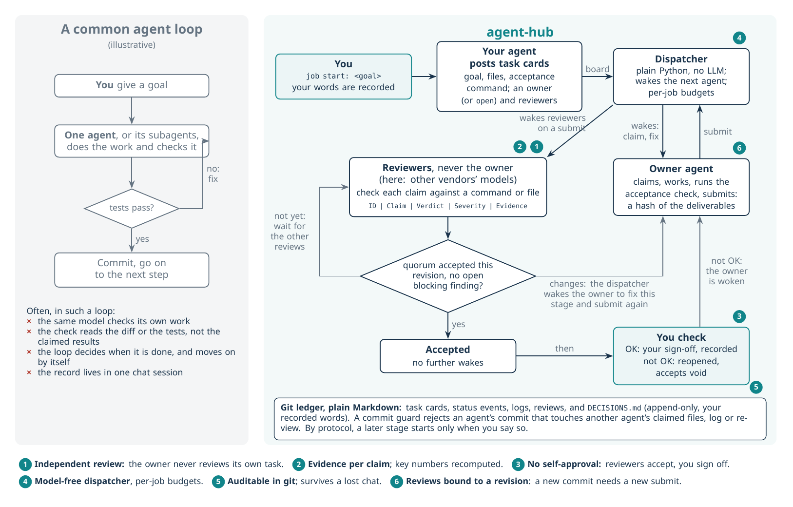

# agent-hub

Three AI coding agents work in one git repository and check each other's work: Claude Code, OpenAI Codex and DeepSeek. One agent owns a task, and one or more of the other agents review it against evidence. Reviewers accept a task; you then sign off with OK or reopen it with not OK. The agents coordinate through plain Markdown files in the repository. A small Python program, with no LLM in it, wakes each agent when there is work for it.



## Why use it

In many agent workflows, the agent that did the work also checks it, and the loop decides when it is done. agent-hub separates these roles:

1. **Independent review.** Each task has one owner and its reviewers. At least one reviewer is needed for the task to be accepted. The tools reject a reviewer list that contains the owner, and reject a review by the owner. The tools check agent tags, not which model actually ran. Which model runs behind each tag is your configuration. With one tag per vendor, as in this repository, every review crosses vendors.
2. **Reviewers check the claims, not only the diff.** A review is a table with one row per claim: `ID | Claim | Verdict | Severity | Evidence`. Each verdict is CONFIRMED, WRONG, UNVERIFIED or UNVERIFIABLE. The evidence is a command to rerun or a file and line. The protocol asks each reviewer to recompute at least three key numbers from the raw data. That is a rule for the agents; no tool can verify that it was done. This fits research code, where the deliverable is often a number or a figure rather than a passing test.
3. **No self-approval.** The owner cannot accept its own task. By default every reviewer must accept the current revision with no blocking finding open (`new_task.py --required all`). With `--required any`, one accept is enough. The task is then **accepted**, and the dispatcher wakes nobody for it. Your check comes after that: OK is recorded in `DECISIONS.md` as your sign-off. Not OK reopens the task, voids the accepts and sends it back to the owner. An accepted task already satisfies tasks that depend on it, and a job started with `--auto-end` can end before you check.
4. **The dispatcher has no LLM.** It is plain Python that reads the board every 10 s, so it uses no tokens while there is no work. Each job has three budgets: up to 10 tasks posted, up to 6 wakes per agent per hour and up to 40 wakes in total. When an 11th task is posted, or a wake is due that would go past a wake budget, the dispatcher pauses that job until you resume it. Separately, each wake has a 30-minute wall time. That is a separate limit, not a budget exemption: a wake that times out was counted when it started, and a retry after a timeout counts as another wake (see Limitations).
5. **Everything is auditable in git.** Task cards, status events, logs and reviews are all Markdown files. `job.py` records your decisions in `DECISIONS.md` with the words you gave it, and the commit guard keeps that file append-only. The record survives a crashed or compacted chat, and any agent that can read files can join.
6. **Reviews are bound to a revision.** A submit records a hash of the committed deliverables. If a deliverable is committed again after the submit, no reviewer is woken: the task stays in its review state, and the board says the deliverables changed since the submit and that it waits for the owner to submit again. (If an earlier revision still has an accepting quorum, with no blocking finding open, the state reads `review (deliverables changed)`. Under the default `--required all`, that means every reviewer accepted the same earlier revision.) The owner must submit again before a new review starts. Uncommitted edits do not change the hash.

Two more rules:
- **Commit guard (code).** A git hook rejects an agent's commit if it touches another agent's active claim, log, review or task card, or a `hub_config.json` change that no recorded `user action=set_config` decision allows, or if it rewrites an append-only file. It also refuses any commit, yours included, that adds a key-like string or a secret file such as `.env`. It checks commits, not file edits. An agent can still change those files on disk, and a claim stops guarding its files once its task is accepted or cancelled.
- **Stages (protocol rule).** An accepted task wakes nobody, so a later stage of a task starts only when you say so in chat. No tool checks this. Task cards are written so that a wake does not go on to the next stage.

### Compared with other setups

The first three columns describe common default setups, not every possible configuration; each tool can be configured otherwise.

| | Subagents / agent teams | Role frameworks (CrewAI, AutoGen, …) | Two-model cross-review scripts | **agent-hub** |
|---|---|---|---|---|
| Reviewer differs from the author | usually the same model | configurable | yes, one reviewer | always a different agent tag; one or more reviewers (here: other vendors) |
| What the review checks | usually the output or the diff | usually the output | usually the diff | every claim, with a command or file as evidence |
| Who decides "done" | usually the lead agent | usually the orchestrator | the script or the loop | the reviewers accept; you sign off or reopen |
| Orchestration | an LLM agent | an LLM or code | a script | plain Python, budgets per job |
| Where the record lives | usually the session | usually the process | the session or a PR | Markdown in git |

## How a task moves

1. **Start a job.** You tell an agent `job start: <goal>`. That agent records your words, starts the dispatcher and posts task cards to the job. A card names the goal, the files the task may change, what must not change and the exact acceptance command. It also names the owner and the reviewers. The owner is one agent tag, or `open` for any agent that is neither the poster nor a reviewer.
2. **Claim.** The dispatcher wakes the owner to claim the task. It never wakes the poster to claim a task it posted. An agent that posts a task naming itself as owner claims it in its own chat. While the owner holds the task, only the owner may commit its deliverables. The owner does the work and runs the acceptance command.
3. **Submit.** The owner submits, and the submit records the revision.
4. **Review.** The dispatcher wakes each reviewer that has not yet accepted this revision. A reviewer checks the claims, writes its table, then accepts or asks for changes. While some reviews are still pending, the task waits.
5. **Changes or accept.** If a reviewer asks for changes, the dispatcher wakes the owner after that round's running reviews end. The owner fixes the current stage only and submits again, which wakes the reviewers again. Once the quorum has accepted the current revision and no blocking finding is open, the task is accepted, and no further wakes follow.
6. **Your check.** You say OK or not OK in chat, and the agent records your words. OK needs an accepted task. Not OK works on an accepted task or one still in review: it reopens the task, and the dispatcher wakes the owner while the job is still active and not paused.

The full protocol is in [`docs/agent_hub/README.md`](docs/agent_hub/README.md).

## Quick start

You need:
- Python 3.11 or newer, and git.
- At least two of the agent command-line tools, installed and logged in: `claude` (Claude Code), `codex` (OpenAI Codex) and `dsh` (a DeepSeek harness). The review loop needs two, because the owner may not review its own task. With exactly two, each task has one of them as owner and the other as reviewer.

```bash
git clone https://github.com/xrguin/agent-hub.git
cd agent-hub
python3 setup_hub.py /path/to/your/repo --dry-run   # shows every change, changes nothing
python3 setup_hub.py /path/to/your/repo             # installs, asking before each step
```

The wizard:
- finds your tools, on `PATH` or in the usual install places, and checks your logins;
- writes `hub_config.json` with bare command names, and keeps this machine's full paths in a git-ignored local file;
- copies `docs/agent_hub/` into your repository;
- updates `.gitignore`, `CLAUDE.md` and `AGENTS.md`;
- commits, but never pushes;
- installs the commit guard, runs the self-test, and prints the kickoff prompts.

It never asks for or stores an API key. `--doctor` checks an installed hub without changing anything.

Then, in your repository, tell one agent `job start: <your goal>`. [`README_FIRST.md`](README_FIRST.md) covers the manual install, your first job, and what to adapt: the hard rules, the task categories and the agent tags. [`SETUP_WITH_AGENT.md`](SETUP_WITH_AGENT.md) has a prompt that lets Claude Code, Codex or `dsh` run the setup for you.

## What is in this repository

| Path | Contents |
|---|---|
| `setup_hub.py` | Install wizard (`--dry-run`, `--doctor`, `--yes`) |
| `docs/agent_hub/README.md` | The protocol: write rules, task lifecycle, review format, job board |
| `docs/agent_hub/tools/` | `job.py` (start, end, check, status), `job_act.py` (claim, submit, review, disposition), `job_dispatcher.py`, `new_task.py`, `hub_state.py`, the commit guard and its unit tests |
| `docs/agent_hub/KICKOFF_PROMPT.md` | The prompts to paste into each agent's chat |
| `docs/agent_hub/PROTOCOL_V2_PLAN.md`, `memos/` | Design notes and the history of the protocol |
| `assets/` | The figure above and its TikZ source |

## Limitations

- **The hub is cooperative, not secure.** The commit guard catches mistakes, not bad intent: `git commit --no-verify` skips it, and an agent that leaves its tag out of a commit message is treated as you. A woken agent has write access to the repository, and a headless DeepSeek wake runs shell commands without asking first.
- **The secret check is a best effort.** It knows common key formats, not every secret, and `git commit --no-verify` skips it. It looks only at text added in new commits; `setup_hub.py --doctor` checks tracked files as they are now, not old history. A woken agent can still read your credential files. For a public repository, also turn on GitHub push protection; `--doctor` warns when it is off.
- **On a public repository, the hub's files can go public.** Logs, reviews, task cards and your exact words are committed to `task_branch`, so pushing that branch publishes them. `setup_hub.py --hub-branch hub` keeps them on a branch that is refused on push. The cost is one more step each time you publish ([`README_FIRST.md`](README_FIRST.md), section 8).
- **It is slower and costs more than a single agent.** Every review is another agent run, and a slide review job once used 45.5M input tokens in 22 minutes. The per-job budgets limit the number of wakes. `hub_config.json` has a token budget, but the dispatcher does not measure tokens yet, so that budget never triggers.
- **A wake has a 30-minute wall.** The dispatcher kills a wake that runs longer, with its whole process group. What follows depends on the task:
  - If the killed agent still holds the task as `claimed` (it had not submitted), the claim is released and the task is Open again. The dispatcher re-wakes an eligible agent for it once per job: the named owner, or for an `open` task any agent that is neither the poster nor a reviewer. A named owner that also posted the task is not woken; it must claim the task again in its own chat. After a second such timeout the task stays Open, nobody is woken for it, and the board lists it under Paused.
  - In every other case (a reviewer's wake, the owner's wake after its submit or on a fix, or a wake that had not claimed yet), nothing is released, no retry is counted and the task keeps its state. The dispatcher does not repeat that wake.
  - A timeout does not pause the job. If the dispatcher cannot stop the process group, it does not release the task (the task keeps its state, for a reviewer's wake `review`) and pauses the job.
- **The job board is in trial.** When a wake does not do what you expect, read its run log in `docs/agent_hub/logs/dispatcher_runs/`.
- **The three agent tags are fixed** (`claude`, `gpt`, `deepseek`). Adding a fourth agent needs a code change.

## Running the tests

```bash
python3 -m unittest discover -s docs/agent_hub/tools -p 'test_*.py'
```

`test_watch_wakes.py` has two tests that can fail because of your environment, not the hub: one if `NO_COLOR` is set, one if the folder path is very long. Run them with `env -u NO_COLOR` from a short path before you suspect the hub.

## License

[MIT](LICENSE)
